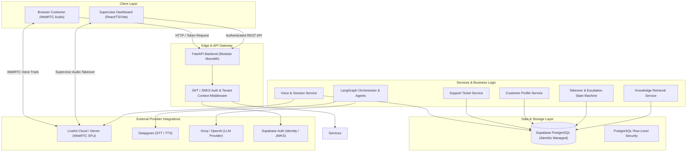

# Epoxa Architecture & Trust Boundaries

## 1. System Overview
Epoxa is structured as a clean, high-performance modular monolith. It provides a browser-based real-time voice interface for customers and an authenticated dashboard for supervisors.



## 2. Trust Boundaries & Security Model

### 2.1. Client to Backend Trust Boundary
- **No Direct Database Access**: The browser client NEVER connects directly to Supabase PostgreSQL or executes arbitrary queries. All database interactions occur via FastAPI repository layers.
- **Short-Lived Room Tokens**: The client requests a short-lived, cryptographically signed LiveKit token with bounded room access and permissions. No LiveKit API secret is ever revealed to the client.
- **Token-Based Supervisor Auth**: Supervisors authenticate with Supabase Auth. The frontend transmits a Bearer JWT. FastAPI validates the token signature against Supabase JWKS, verifying audience (`authenticated`), issuer, expiration, and user claims.
- **Server-Derived Context**: Tenant membership (`organization_id`, `role`) is resolved from the database using the verified JWT `sub` (user UUID). Client-supplied tenant IDs in request bodies are never trusted blindly.

### 2.2. Provider Isolation
- **Narrow Adapters**: Third-party SDKs (LiveKit, Deepgram, Groq) are encapsulated behind modular adapter interfaces (`app.integrations.*`).
- **Graceful Provider Fallback**: If an external provider is temporarily unavailable or credentials are missing in local dev, mock/fallback adapters activate and raise predictable domain errors rather than crashing the system.

### 2.3. Data Isolation & Tenant Boundaries
- Every database entity belongs to an `organization_id` (either directly or via parent relations).
- Composite foreign keys prevent cross-tenant referencing (e.g. a ticket in Tenant A referencing a customer in Tenant B is rejected at the database engine level).
- API routes explicitly apply tenant filtering to all queries.

## 3. Directory Layout
```text
epoxa/
├── backend/
│   ├── app/
│   │   ├── api/v1/          # Versioned REST endpoints
│   │   ├── core/            # Config, security, logging, exceptions
│   │   ├── db/              # Database session, models, migrations
│   │   ├── models/          # SQLAlchemy 2.0 ORM models
│   │   ├── schemas/         # Pydantic schemas (Request/Response)
│   │   ├── repositories/    # Clean DB query layer
│   │   ├── services/        # Domain business logic & state machines
│   │   ├── agents/          # LangGraph orchestrator, tools, prompts
│   │   ├── integrations/    # LiveKit, Deepgram, Groq, Supabase Auth
│   │   └── scripts/         # Demo seed, retention cleanup, diagnostics
│   ├── alembic/             # Version-controlled DB migrations
│   └── tests/               # Pytest suite (unit, integration, tenant-isolation)
├── frontend/                # React 18 + TypeScript + Vite app
│   ├── src/
│   │   ├── api/             # Typed API client
│   │   ├── components/      # UI components (Voice customer & Supervisor)
│   │   ├── hooks/           # Voice, audio, live session hooks
│   │   ├── pages/           # Customer Voice view & Supervisor Dashboard
│   │   └── types/           # Shared TypeScript interfaces
├── docs/                    # Specifications, architecture, ERD, runbooks
├── .env.example
├── .gitignore
├── pyproject.toml
└── README.md
```
