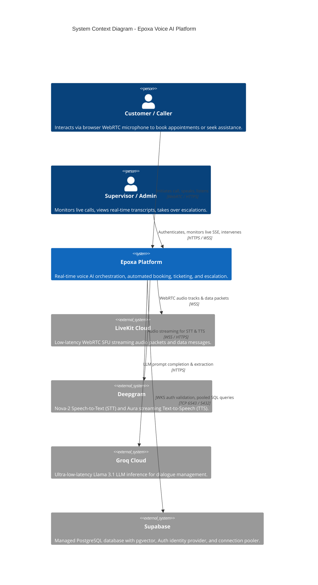
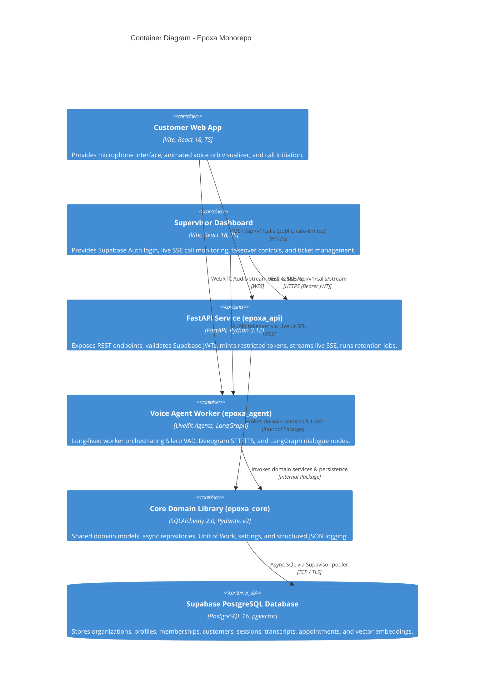
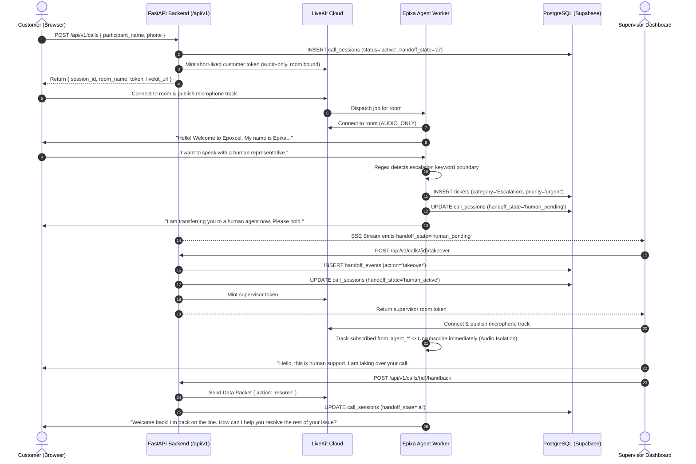

# Epoxa: Production Architecture & System Specification

**Product:** Epoxa Real-Time Voice AI Agent & Supervisor Console  
**Organization:** Epoxcel  
**Agent Persona:** Epixa  
**Status:** Production Launch-Ready Architecture  

---

## 1. System Overview

Epoxa is an enterprise-grade real-time Voice AI agent platform providing natural speech interactions for inbound customer service, appointment scheduling, grievance registration, and real-time supervisor escalation with human takeover.

### Key Architectural Pillars
1. **Clean Modular Monorepo:** Structured using `uv` (Python 3.12) and `pnpm` (TypeScript) workspaces. Repositories and domain logic live in `packages/core`, strictly consumed by `apps/api` and `apps/agent`. No circular dependencies or `sys.path` hacks.
2. **PostgreSQL Relational Single Source of Truth:** 12 normalized tables versioned with Alembic, featuring database-level triggers, Row Level Security (RLS) enforced across all tables, and least-privilege roles (`epoxa_api`, `epoxa_agent`, `epoxa_migrator`).
3. **Stateless Voice Agent Workers:** Vector similarity search powered by `pgvector` (`kb_chunks` with HNSW cosine index) and in-memory caching, replacing local file-based ChromaDB.
4. **Off-the-Hot-Path Persistence:** Real-time speech transcription and latency measurements are buffered via a bounded asynchronous queue, guaranteeing that database write latencies never degrade live WebRTC audio streams.
5. **Server-Authoritative Escalation & Handoff:** Call states (`ai`, `human_pending`, `human_active`) are authoritatively tracked in PostgreSQL with append-only audit logging and WebRTC track isolation.
6. **Supervisor RBAC & Auth:** Secured via Supabase Auth asymmetric JWKS JWT verification. Public endpoints are rate-limited with concurrent call caps.

---

## 2. C4 Architecture Diagrams

### 2.1 System Context Diagram (C4 Level 1)

### 2.2 Container Diagram (C4 Level 2)

---

## 3. High-Level Call Flow & Escalation Sequence

---

## 4. Voice Pipeline Invariants (Non-Negotiable)

1. **Non-Blocking `room.sid`:** LiveKit's `ctx.room.sid` is awaited inside a detached background task (`asyncio.create_task`). It must never block agent startup or greeting playback.
2. **Multi-Participant Track Isolation:** Audio tracks from participants starting with `agent_` or `human_` are immediately unsubscribed (`publication.set_subscribed(False)`), preventing audio echo and acoustic interference.
3. **DOM Audio Element Attachment:** In the React client, `track.attach()` elements are explicitly appended to `document.body` to prevent browser garbage collection of the audio context.
4. **Word-Boundary Escalation Detection:** Regex `\b(speak to a human|talk to a human|transfer me|...)\b` prevents false-positives on words like "superhuman" or general conversational mentions.
5. **Calibrated Pipeline Latency Timings:**
   - `interrupt_speech_duration = 0.7s`
   - `interrupt_min_words = 2`
   - `min_endpointing_delay = 0.6s`
   - `preemptive_synthesis = False`
