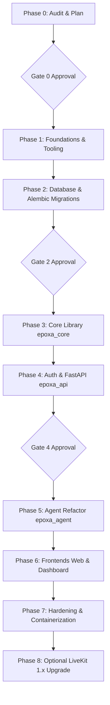

# Epoxa: Production Architecture Implementation Plan

**Project:** Epoxa — Production Architecture Overhaul  
**Plan Date:** October 25, 2026  
**Status:** Draft — Awaiting Gate 0 Explicit Approval  

---

## 1. Plan Overview & Execution Principles

This implementation plan outlines the transformation of Epoxa from a prototype codebase into a production-grade, multi-tenant voice AI application. 

### Operating Principles
1. **Zero Downtime / Always Runnable:** At every phase boundary, the application must be buildable, testable, and runnable.
2. **Strict Layering:** `Routes -> Services -> Repositories -> Models`. No circular imports. `apps/` depend on `packages/core`, never the reverse.
3. **No Legacy Data Migration:** Fresh start with clean Alembic migrations against Supabase PostgreSQL; legacy SQLite (`voice_support.db`) is decommissioned.
4. **Gate-Driven Approvals:** Explicit user confirmation is required at Gate 0, Gate 2, and Gate 4 before executing mutating actions.
5. **Git Safety Compliance:** All Git operations must be user-confirmed with explicit command prompts and target branch notifications.

---

## 2. Phase-by-Phase Task Breakdown

---

### Phase 0: Audit and Plan (Read-Only Baseline)
- [x] Inspect existing codebase, virtual environments, configuration, and Git history.
- [x] Scan Git commit objects for hardcoded credentials (verified clean).
- [x] Produce `docs/audit/audit.md` detailing discrepancies, technical debt, and invariants.
- [x] Produce `docs/audit/implementation_plan.md` mapping out all phases and tasks.
- [x] Assemble batched list of open questions and `ACTION REQUIRED FROM OWNER` items.
- [x] **GATE 0: Present audit and plan to the owner and await explicit approval.**

---

### Phase 1: Foundations & Monorepo Tooling (No Behavior Change)
*Goal: Establish target directory structure, hermetic package managers, linting, and formatting.*

1. **Target Directory Restructuring:**
   - Create directories: `apps/api`, `apps/agent`, `apps/web`, `apps/dashboard`, `packages/core`, `packages/api-client`, `packages/ui-tokens`, `db/migrations`, `db/seeds`, `infra/docker`, `infra/scripts`.
2. **Python Workspace (`uv`):**
   - Initialize root `pyproject.toml` with `uv` workspace members (`packages/core`, `apps/api`, `apps/agent`).
   - Configure Python 3.12 compatibility.
   - Set up `ruff` (linter and formatter) and `mypy --strict`.
3. **Node.js Workspace (`pnpm`):**
   - Activate `pnpm` via corepack (`corepack enable pnpm`).
   - Create `pnpm-workspace.yaml` containing `apps/web`, `apps/dashboard`, `packages/api-client`, `packages/ui-tokens`.
4. **Design Tokens Extraction:**
   - Extract shared CSS variables, glassmorphism tokens, and orb animations from `design-system.css` into `packages/ui-tokens`.
5. **Base Configuration & Structured Logging:**
   - Implement `epoxa_core.settings` using `pydantic-settings` (`SecretStr`, fail-fast validation).
   - Implement structured JSON logging via `structlog` writing to `stdout`.
6. **Developer Ergonomics:**
   - Create root `Makefile` (`make dev`, `make test`, `make lint`, `make migrate`, `make seed`).
   - Create `.env.example` templates for root, api, agent, and frontends.
   - Configure `.pre-commit-config.yaml`.
7. **Verification:**
   - Execute `make lint` and verify clean formatting across Python and TypeScript.

---

### Phase 2: Database Architecture (Supabase PostgreSQL + Alembic)
*Goal: Production-ready relational schema with Alembic migrations, RLS, and least-privilege roles.*

1. **Schema Design Document:**
   - Author `docs/database/schema.md` with complete Mermaid ERD, column data dictionary, PII tagging, and index justifications.
2. **SQLAlchemy 2.0 Async Models:**
   - Define declarative models in `epoxa_core.models` using `Mapped[...]` and custom naming conventions (`ix_`, `uq_`, `ck_`, `fk_`, `pk_`):
     - `organizations` (multi-tenant foundation, timezone, business hours, settings)
     - `profiles` (linked to `auth.users(id)`)
     - `memberships` (`owner`, `admin`, `supervisor`)
     - `customers` (E.164 phone check, anonymization support)
     - `call_sessions` (server room name, `handoff_state`, duration, metrics)
     - `call_transcripts` (`UNIQUE(session_id, sequence)`)
     - `latency_logs` (BRIN index on `logged_at`)
     - `handoff_events` (append-only audit log)
     - `appointments` (`scheduled_at TIMESTAMPTZ`, unambiguous confirmation code, partial unique index per org)
     - `tickets` (`TKT-XXXXXX` human identity, category, priority, status)
     - `audit_logs` (append-only compliance trail)
     - `kb_documents` & `kb_chunks` (pgvector 384-dim HNSW cosine index)
3. **Alembic Configuration (`db/`):**
   - Configure async `env.py` with `include_object` filtering out Supabase schemas (`auth`, `storage`, `realtime`).
   - Generate initial migration revision covering all tables, triggers (`set_updated_at`), and indexes.
4. **Row Level Security (RLS) & Role Grants:**
   - Add migration script enforcing RLS on all public tables:
     - `REVOKE ALL ON ALL TABLES IN SCHEMA public FROM anon, authenticated;`
   - Define application Postgres roles: `epoxa_api`, `epoxa_agent`, and `epoxa_migrator`.
5. **Idempotent Seeds (`db/seeds/`):**
   - Seed scripts for default organization ("Epoxcel"), initial administrator, and FAQ knowledge base vectors.
6. **Supabase Connection Configuration:**
   - Runtime: Supavisor transaction pooler (port 6543) with `statement_cache_size=0`.
   - Migration: Direct/session connection (port 5432).
7. **GATE 2: Present schema and migration files to the owner for approval before applying to Supabase.**

---

### Phase 3: Core Library (`epoxa_core`)
*Goal: Implement shared domain logic, repositories, and business services.*

1. **Async Database Engine & Unit of Work:**
   - Implement `DatabaseSessionManager` with connection pooling, health checks, and explicit transaction demarcation.
2. **Repository Layer (SQL Only):**
   - `OrganizationRepository`
   - `CustomerRepository` (E.164 phone lookup, create, anonymize)
   - `CallSessionRepository` (session tracking, handoff state update, duration calculation)
   - `TranscriptRepository` (batch turn ingestion)
   - `AppointmentRepository` (slot conflict verification, booking, rescheduling)
   - `TicketRepository` (ticket creation, status/assignment update)
   - `AuditLogRepository` (append-only logging)
   - `KBRepository` (pgvector similarity search)
3. **Service Layer (Business Logic & Transactions):**
   - `AppointmentService`: Validates natural-language slot requests against business hours (`Asia/Kolkata`, Mon–Sat 09:00–18:00), verifies slot availability, generates unambiguous confirmation codes.
   - `CustomerService`: Normalizes phone numbers to E.164 (`IN` default), handles GDPR/privacy customer anonymization.
   - `CallSessionService`: Handles call lifecycle, updates handoff states, coordinates audit logs.
   - `KBService`: Manages embedding generation and similarity retrieval with caching.
4. **Domain Exceptions & RFC 7807 Mapping:**
   - Define core exceptions: `EntityNotFound`, `ConflictError`, `ValidationError`, `UnauthorizedError`, `ForbiddenError`.
5. **Unit & Repository Tests:**
   - Execute comprehensive async test suite with SQLite/Postgres test fixtures achieving >= 85% coverage.

---

### Phase 4: Authentication & Backend API (`epoxa_api`)
*Goal: Secure FastAPI service with Supabase JWT validation, RBAC, SSE streaming, and OpenAPI generation.*

1. **FastAPI Application Setup (`apps/api`):**
   - Initialize FastAPI with RFC 7807 exception handlers, CORS allowlist, request-ID middleware, and security headers.
2. **Supabase Auth & RBAC Middleware:**
   - Asymmetric JWT verification using Supabase JWKS endpoint with local TTL cache and fallback.
   - Reusable dependency guards: `require_authenticated_profile`, `require_role("supervisor")`, `require_role("admin")`.
   - All queries automatically scoped to `organization_id` extracted from JWT claims.
3. **Public Endpoints (Secured & Rate-Limited):**
   - `POST /api/v1/calls`: Generates unique room name, records `call_sessions` row, mints restricted audio-only customer token, dispatches agent. Includes rate limiting (`slowapi`) and concurrent call cap enforcement.
   - `/health/live` & `/health/ready`: Sanitized readiness and liveness checks.
4. **Supervisor & Admin Endpoints (Authenticated & Paginated):**
   - `GET /api/v1/me`: Profile and membership details.
   - `GET /api/v1/calls`: Bounded, paginated call session list.
   - `GET /api/v1/calls/{id}/transcript`: Chronological transcript records.
   - `GET /api/v1/calls/stream`: **Server-Sent Events (SSE)** endpoint streaming live call list and active transcripts (replaces frontend polling).
   - `POST /api/v1/calls/{id}/takeover`: Server-side state transition to `human_active`, records handoff event and audit log, mints supervisor token.
   - `POST /api/v1/calls/{id}/handback`: Server-authoritative resume signal via LiveKit Server API, sets `handoff_state` to `ai`.
   - `POST /api/v1/calls/{id}/end`: Terminates room cleanly via LiveKit Server API.
   - CRUD endpoints for `customers`, `appointments`, `tickets`, and `admin/members`.
5. **Background Scheduled Workers:**
   - Advisory-locked reconciliation job auto-healing stale rooms (preserving 60-second grace period).
   - Advisory-locked retention job purging transcripts (>90 days) and latencies (>30 days).
6. **OpenAPI TypeScript Client Generation:**
   - Automate OpenAPI export and generate `@epoxa/api-client` inside `packages/api-client`.
7. **GATE 4: Owner review of API, authentication flow, and integration test results.**

---

### Phase 5: Voice Agent Refactor (`epoxa_agent`)
*Goal: Stateless, robust LiveKit voice agent utilizing `epoxa_core` and database-backed state.*

1. **Clean Package Layout (`apps/agent`):**
   - Eliminate `sys.path.insert` hacks and local HTTP calls to localhost.
   - Consume `epoxa_core` services directly with least-privilege DB role (`epoxa_agent`).
2. **Dependency Injection into LangGraph Nodes:**
   - Inject services and config into node execution contexts (`AppointmentService`, `CustomerService`, `KBService`).
3. **Persisted Appointment Booking Flow:**
   - Refactor `appointment_node` to parse spoken dates/times, validate against `AppointmentService`, book the slot in PostgreSQL, and speak the true confirmation code.
4. **Authoritative Handoff State:**
   - Remove `_active_handoffs` dictionary. Read authoritative handoff state from `call_sessions.handoff_state` with local process caching.
   - Listen to server-authoritative resume signals.
5. **Off-the-Hot-Path Persistence:**
   - Implement an asynchronous, bounded in-memory buffer with retry backoff for transcript turns and latency metrics. DB write slowdowns will never degrade audio streaming.
6. **Preservation of Critical Invariants:**
   - Await `room.sid` in background task without blocking agent entrypoint.
   - Multi-participant audio track isolation (`agent_*` and `human_*` participants ignored).
   - Voice pipeline timings preserved: `interrupt_speech_duration = 0.7s`, `interrupt_min_words = 2`, `min_endpointing_delay = 0.6s`, `preemptive_synthesis = False`.
7. **pgvector Knowledge Base Integration:**
   - Replace local ChromaDB with pgvector queries against `kb_chunks`. Pre-warm embeddings during worker startup.
8. **Graceful Shutdown:**
   - Handle `SIGTERM` by finishing active calls, flushing transcript buffers, and marking final call status.

---

### Phase 6: Frontends Overhaul (`apps/web` & `apps/dashboard`)
*Goal: Modern Vite + TypeScript frontends utilizing shared tokens and generated API clients.*

1. **Toolchain Migration:**
   - Initialize `apps/web` and `apps/dashboard` with Vite, React 18, and TypeScript (`strict: true`).
   - Import design tokens from `@epoxa/ui-tokens` and API client from `@epoxa/api-client`.
2. **Customer Web App (`apps/web`):**
   - Single "Start Voice Call" interface calling `POST /api/v1/calls` (room input removed).
   - Port `LiveKitHelper` to TypeScript with full track lifecycle management and explicit DOM attachment to prevent browser garbage collection.
   - Modern permission guidance, device selector, and glowing orb visualizer.
3. **Supervisor Admin Dashboard (`apps/dashboard`):**
   - Supabase Auth sign-in and session auto-refresh (no direct table access).
   - Real-time active calls and live transcript view powered by SSE (`/api/v1/calls/stream`).
   - Server-authoritative "Takeover Call" and "Hand Back to AI" action buttons with confirmation modals.
   - Team member management, customer profile anonymization, and ticket queue management.
4. **Automated Testing:**
   - Unit tests with Vitest + React Testing Library.
   - Playwright E2E smoke tests for login, call start, and takeover.

---

### Phase 7: Hardening, Observability & Release Readiness
*Goal: Production containerization, security validation, and deployment runbooks.*

1. **Containerization (`infra/docker`):**
   - Multi-stage, non-root Dockerfiles for `api`, `agent`, `web`, and `dashboard`.
   - `infra/docker/compose.dev.yml` for single-command local development.
2. **Security Verification:**
   - Verify zero findings on `pip-audit`, `pnpm audit`, and `gitleaks`.
   - Automated tests proving `anon` and `authenticated` roles cannot access `public` schema tables directly.
3. **Observability & Metrics:**
   - Prometheus metrics for active calls, turn latencies (STT/LLM/TTS/e2e percentiles), and DB pool utilization.
   - Latency analysis CLI script over `latency_logs`.
4. **Documentation & Runbooks:**
   - Complete `README.md`, `SECURITY.md`, `CONTRIBUTING.md`, `docs/runbooks/` (deployment, secret rotation, stuck calls), and updated `PROJECT_CONTEXT.md`.

---

### Phase 8: Optional `livekit-agents` 1.x Upgrade
*Goal: Upgrade agent worker to LiveKit Agents 1.x behind regression tests.*
- Executed on a dedicated branch only after explicit approval.
- Migrate `VoicePipelineAgent` to `AgentSession`.
- Benchmark before-and-after latency.

---

*This plan is ready for review at Gate 0.*
