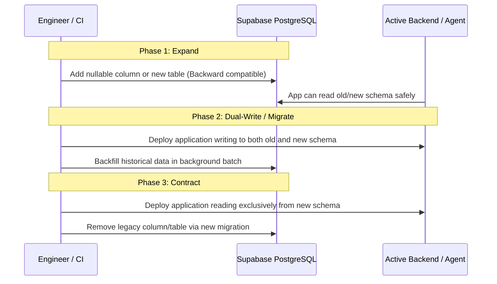

# Epoxa: Database Migration Guide & Zero-Downtime Expand/Contract Playbook

**Migration Engine:** Alembic (Async)  
**Target:** PostgreSQL 15+ on Supabase  
**CLI Tooling:** `make migrate`  

---

## 1. Migration Execution Rules

1. **Explicit Release Phase Execution:**
   - Migrations are **never executed automatically at application startup**.
   - Migrations are run as a discrete release step:
     ```bash
     make migrate
     ```
2. **Deterministic Constraint Naming:**
   - All constraints and indexes follow the deterministic naming convention defined in `epoxa_core.models.base.POSTGRES_NAMING_CONVENTION`.
   - Never write anonymous constraints.
3. **No Legacy Data Migration:**
   - The initial schema deployment (Revision `0001_initial_schema`) creates fresh normalized tables. Legacy SQLite (`voice_support.db`) is not imported.

---

## 2. Zero-Downtime Expand / Contract Pattern

When modifying the production database schema while traffic is active, follow the **Expand and Contract** protocol across multiple deployments:



### 2.1 Adding a Required (NOT NULL) Column
1. **Migration 1 (Expand):** Add column as `NULLABLE`.
2. **Deploy Application:** Application begins writing to the new column.
3. **Backfill:** Populate historical rows with default values.
4. **Migration 2 (Contract):** Alter column to `NOT NULL`.

### 2.2 Renaming a Column
1. **Migration 1 (Expand):** Add new column name.
2. **Deploy Application:** Read from new column if present, fallback to old; write to both.
3. **Backfill:** Copy values from old column to new.
4. **Migration 2 (Contract):** Drop old column.

---

## 3. Verification & Drift Check Commands

Run migration checks to verify zero drift between SQLAlchemy models and the database:

```bash
# Apply pending migrations
make migrate

# Check for schema drift between models and migration revisions
uv run alembic -c db/alembic.ini check
```
