# Epoxa: PostgreSQL Database Schema & Architecture Specification

**Database Target:** PostgreSQL 15+ on Supabase  
**Migration Tool:** Alembic (Async)  
**ORM:** SQLAlchemy 2.0 (`Mapped[...]`)  
**Design Status:** Approved Production Schema  

---

## 1. Entity-Relationship Diagram (Mermaid)

```mermaid
erDiagram
    organizations ||--o{ memberships : has
    organizations ||--o{ customers : registers
    organizations ||--o{ call_sessions : tracks
    organizations ||--o{ appointments : schedules
    organizations ||--o{ tickets : manages
    organizations ||--o{ kb_documents : owns
    organizations ||--o{ audit_logs : records

    profiles ||--o{ memberships : holds
    profiles ||--o{ handoff_events : executes
    profiles ||--o{ tickets : assigned_to

    customers ||--o{ call_sessions : initiates
    customers ||--o{ appointments : books
    customers ||--o{ tickets : files

    call_sessions ||--o{ call_transcripts : contains
    call_sessions ||--o{ latency_logs : measures
    call_sessions ||--o{ handoff_events : logs
    call_sessions ||--o{ appointments : originates
    call_sessions ||--o{ tickets : escalates_to

    kb_documents ||--o{ kb_chunks : splits_into

    organizations {
        uuid id PK
        string name
        string slug UK
        string timezone
        jsonb settings
        timestamptz created_at
        timestamptz updated_at
    }

    profiles {
        uuid id PK
        string email UK
        string full_name
        string avatar_url
        boolean is_active
        timestamptz last_seen_at
        timestamptz created_at
        timestamptz updated_at
    }

    memberships {
        uuid id PK
        uuid organization_id FK
        uuid profile_id FK
        string role
        boolean is_active
        timestamptz created_at
        timestamptz updated_at
    }

    customers {
        uuid id PK
        uuid organization_id FK
        string name
        string phone_e164
        string email
        string tier
        jsonb metadata
        timestamptz anonymized_at
        timestamptz created_at
        timestamptz updated_at
    }

    call_sessions {
        uuid id PK
        uuid organization_id FK
        string room_name UK
        string livekit_room_sid
        string participant_identity
        string participant_name
        uuid customer_id FK
        string status
        string handoff_state
        timestamptz started_at
        timestamptz ended_at
        integer duration_seconds
        string end_reason
        text summary
        string agent_version
        string prompt_version
        string llm_model
        timestamptz created_at
        timestamptz updated_at
    }

    call_transcripts {
        bigint id PK
        uuid session_id FK
        string role
        string speaker_identity
        string content
        integer sequence
        timestamptz spoken_at
        jsonb metadata
    }

    latency_logs {
        bigint id PK
        uuid session_id FK
        integer turn_index
        string step
        double_precision duration_ms
        timestamptz logged_at
    }

    handoff_events {
        uuid id PK
        uuid session_id FK
        uuid profile_id FK
        string action
        text notes
        timestamptz created_at
    }

    appointments {
        uuid id PK
        uuid organization_id FK
        uuid customer_id FK
        uuid session_id FK
        timestamptz scheduled_at
        integer duration_minutes
        string timezone
        string confirmation_code UK
        string status
        text notes
        timestamptz cancelled_at
        string cancellation_reason
        timestamptz created_at
        timestamptz updated_at
    }

    tickets {
        uuid id PK
        bigint number UK
        uuid organization_id FK
        uuid customer_id FK
        uuid session_id FK
        string category
        string priority
        string description
        string status
        uuid assigned_to FK
        timestamptz resolved_at
        timestamptz created_at
        timestamptz updated_at
    }

    audit_logs {
        uuid id PK
        uuid organization_id FK
        uuid actor_profile_id FK
        string action
        string entity_type
        string entity_id
        string ip
        string request_id
        jsonb metadata
        timestamptz created_at
    }

    kb_documents {
        uuid id PK
        uuid organization_id FK
        string title
        string source_path
        string content_hash
        boolean is_active
        timestamptz created_at
        timestamptz updated_at
    }

    kb_chunks {
        uuid id PK
        uuid document_id FK
        uuid organization_id FK
        text content
        integer position
        vector_384 embedding
    }
```

---

## 2. Comprehensive Column Data Dictionary

### 2.1 `organizations`
| Column | Type | Constraints & Defaults | PII? | Description |
| :--- | :--- | :--- | :--- | :--- |
| `id` | UUID | PK, `gen_random_uuid()` | No | Unique organization identifier. |
| `name` | VARCHAR(100) | NOT NULL | No | Human-readable tenant name (e.g., "Epoxcel"). |
| `slug` | VARCHAR(60) | UNIQUE, NOT NULL, Index | No | URL-friendly identifier ("epoxcel"). |
| `timezone` | VARCHAR(50) | NOT NULL, DEFAULT 'Asia/Kolkata' | No | IANA timezone for business operating hours. |
| `settings` | JSONB | NOT NULL, DEFAULT JSON | No | Tenant business hours, default phone region, retention rules. |
| `created_at` | TIMESTAMPTZ | NOT NULL, DEFAULT NOW() | No | Creation timestamp (UTC). |
| `updated_at` | TIMESTAMPTZ | NOT NULL, DEFAULT NOW() | No | Maintained via DB trigger `set_updated_at()`. |

### 2.2 `profiles` (Linked to `auth.users`)
| Column | Type | Constraints & Defaults | PII? | Description |
| :--- | :--- | :--- | :--- | :--- |
| `id` | UUID | PK, FK `auth.users(id)` ON DELETE CASCADE | No | Supabase Auth user identity. |
| `email` | VARCHAR(255) | UNIQUE, NOT NULL, Index | **YES** | Supervisor email address. |
| `full_name` | VARCHAR(150) | NOT NULL | **YES** | Supervisor legal or display name. |
| `avatar_url` | VARCHAR(500) | NULL | No | Profile photo CDN link. |
| `is_active` | BOOLEAN | NOT NULL, DEFAULT TRUE | No | Account status flag. |
| `last_seen_at` | TIMESTAMPTZ | NULL | No | Last authenticated activity timestamp. |
| `created_at` | TIMESTAMPTZ | NOT NULL, DEFAULT NOW() | No | Creation timestamp. |
| `updated_at` | TIMESTAMPTZ | NOT NULL, DEFAULT NOW() | No | Maintained via trigger. |

### 2.3 `memberships`
| Column | Type | Constraints & Defaults | PII? | Description |
| :--- | :--- | :--- | :--- | :--- |
| `id` | UUID | PK, `gen_random_uuid()` | No | Membership record identity. |
| `organization_id` | UUID | FK `organizations(id)` ON DELETE CASCADE, Index | No | Tenant link. |
| `profile_id` | UUID | FK `profiles(id)` ON DELETE CASCADE, Index | No | User link. |
| `role` | VARCHAR(20) | CHECK IN ('owner', 'admin', 'supervisor') | No | Role-based authorization tier. |
| `is_active` | BOOLEAN | NOT NULL, DEFAULT TRUE | No | Membership status flag. |
| *Constraint* | - | UNIQUE (`organization_id`, `profile_id`) | No | One membership per user per organization. |

### 2.4 `customers`
| Column | Type | Constraints & Defaults | PII? | Description |
| :--- | :--- | :--- | :--- | :--- |
| `id` | UUID | PK, `gen_random_uuid()` | No | Customer record identity. |
| `organization_id` | UUID | FK `organizations(id)` ON DELETE CASCADE, Index | No | Tenant link. |
| `name` | VARCHAR(150) | NOT NULL | **YES** | Caller name provided during registration or speech. |
| `phone_e164` | VARCHAR(20) | CHECK `phone_e164 ~ '^\+[1-9][0-9]{7,14}$'` | **YES** | Standardized E.164 phone number. |
| `email` | VARCHAR(255) | NULL | **YES** | Optional customer contact email. |
| `tier` | VARCHAR(20) | CHECK IN ('Basic', 'Standard', 'Premium', 'VIP') | No | Loyalty or SLA tier. |
| `metadata` | JSONB | NOT NULL, DEFAULT `{}` | No | Arbitrary CRM attributes. |
| `anonymized_at` | TIMESTAMPTZ | NULL | No | Timestamp of GDPR anonymization (if requested). |
| *Index* | - | UNIQUE (`organization_id`, `phone_e164`) WHERE `anonymized_at IS NULL` | No | Prevents duplicate active registrations. |

### 2.5 `call_sessions`
| Column | Type | Constraints & Defaults | PII? | Description |
| :--- | :--- | :--- | :--- | :--- |
| `id` | UUID | PK, `gen_random_uuid()` | No | Session identifier. |
| `organization_id` | UUID | FK `organizations(id)` ON DELETE CASCADE, Index | No | Tenant link. |
| `room_name` | VARCHAR(128) | UNIQUE, NOT NULL, Index | No | Cryptographically generated server room name. |
| `livekit_room_sid` | VARCHAR(64) | NULL | No | LiveKit internal SID resolved asynchronously. |
| `participant_identity` | VARCHAR(64) | NULL | No | Ephemeral WebRTC client identity. |
| `participant_name` | VARCHAR(150) | NULL | **YES** | Caller name entered in client. |
| `customer_id` | UUID | FK `customers(id)` ON DELETE SET NULL, Index | No | Verified caller profile link. |
| `status` | VARCHAR(20) | CHECK IN ('active', 'escalated', 'completed', 'dropped', 'timeout', 'error') | No | Session lifecycle state. |
| `handoff_state` | VARCHAR(20) | CHECK IN ('ai', 'human_pending', 'human_active') | No | Authoritative takeover state. |
| `started_at` | TIMESTAMPTZ | NOT NULL, DEFAULT NOW() | No | Call start timestamp. |
| `ended_at` | TIMESTAMPTZ | NULL | No | Call termination timestamp. |
| `duration_seconds` | INTEGER | NOT NULL, DEFAULT 0, CHECK >= 0 | No | Total elapsed call seconds. |
| `end_reason` | VARCHAR(255) | NULL | No | Reason for disconnect ("hangup", "timeout", etc.). |
| `summary` | TEXT | NULL | No | Post-call LLM 2-3 sentence summary. |
| `agent_version` | VARCHAR(30) | NOT NULL, DEFAULT '1.0.0' | No | Agent codebase release version. |
| `prompt_version` | VARCHAR(30) | NOT NULL, DEFAULT 'v1' | No | Version of system prompt used. |
| `llm_model` | VARCHAR(60) | NOT NULL, DEFAULT 'llama-3.1-8b-instant' | No | Inference model used for conversation. |

### 2.6 `call_transcripts`
| Column | Type | Constraints & Defaults | PII? | Description |
| :--- | :--- | :--- | :--- | :--- |
| `id` | BIGINT | IDENTITY PRIMARY KEY | No | Monotonic row counter. |
| `session_id` | UUID | FK `call_sessions(id)` ON DELETE CASCADE, Index | No | Session link. |
| `role` | VARCHAR(20) | CHECK IN ('user', 'agent', 'supervisor') | No | Utterance speaker role. |
| `speaker_identity` | VARCHAR(64) | NULL | No | WebRTC participant identity. |
| `content` | VARCHAR(4000) | NOT NULL | **YES** | Spoken utterance transcript text. |
| `sequence` | INTEGER | NOT NULL | No | Chronological turn index (1, 2, 3...). |
| `spoken_at` | TIMESTAMPTZ | NOT NULL, DEFAULT NOW() | No | Spoken timestamp. |
| `metadata` | JSONB | NOT NULL, DEFAULT `{}` | No | Speech confidence, STT tokens. |
| *Constraint* | - | UNIQUE (`session_id`, `sequence`) | No | Guarantees ordering and deduplication. |

### 2.7 `latency_logs`
| Column | Type | Constraints & Defaults | PII? | Description |
| :--- | :--- | :--- | :--- | :--- |
| `id` | BIGINT | IDENTITY PRIMARY KEY | No | Monotonic counter. |
| `session_id` | UUID | FK `call_sessions(id)` ON DELETE CASCADE, Index | No | Session link. |
| `turn_index` | INTEGER | NOT NULL, DEFAULT 0 | No | Associated conversation turn. |
| `step` | VARCHAR(20) | CHECK IN ('stt', 'llm', 'tts', 'e2e') | No | Voice pipeline benchmarked stage. |
| `duration_ms` | DOUBLE PRECISION | NOT NULL, CHECK >= 0 | No | Elapsed milliseconds. |
| `logged_at` | TIMESTAMPTZ | NOT NULL, DEFAULT NOW(), BRIN Index | No | Measurement timestamp. |

### 2.8 `handoff_events` (Append-Only)
| Column | Type | Constraints & Defaults | PII? | Description |
| :--- | :--- | :--- | :--- | :--- |
| `id` | UUID | PK, `gen_random_uuid()` | No | Event identity. |
| `session_id` | UUID | FK `call_sessions(id)` ON DELETE CASCADE, Index | No | Session link. |
| `profile_id` | UUID | FK `profiles(id)` ON DELETE SET NULL, Index | No | Supervisor actor. |
| `action` | VARCHAR(30) | CHECK IN ('takeover_requested', 'takeover', 'return_to_ai', 'disconnect') | No | State change action. |
| `notes` | TEXT | NULL | No | Optional supervisor rationale. |
| `created_at` | TIMESTAMPTZ | NOT NULL, DEFAULT NOW() | No | Event timestamp. |

### 2.9 `appointments`
| Column | Type | Constraints & Defaults | PII? | Description |
| :--- | :--- | :--- | :--- | :--- |
| `id` | UUID | PK, `gen_random_uuid()` | No | Booking identity. |
| `organization_id` | UUID | FK `organizations(id)` ON DELETE CASCADE, Index | No | Tenant link. |
| `customer_id` | UUID | FK `customers(id)` ON DELETE RESTRICT, Index | No | Customer link (cannot delete customer with bookings). |
| `session_id` | UUID | FK `call_sessions(id)` ON DELETE SET NULL | No | Originating voice call session. |
| `scheduled_at` | TIMESTAMPTZ | NOT NULL, Index | No | Booking slot timestamp (UTC). |
| `duration_minutes` | INTEGER | NOT NULL, DEFAULT 30 | No | Slot length (default 30 mins). |
| `timezone` | VARCHAR(50) | NOT NULL, DEFAULT 'Asia/Kolkata' | No | Operating timezone at booking time. |
| `confirmation_code` | VARCHAR(16) | NOT NULL, UNIQUE per organization | No | Unambiguous human confirmation code (`APT-XXXXXX`). |
| `status` | VARCHAR(20) | CHECK IN ('confirmed', 'cancelled', 'completed', 'rescheduled', 'no_show') | No | Booking status. |
| `notes` | TEXT | NULL | No | Spoken customer agenda / notes. |
| `cancelled_at` | TIMESTAMPTZ | NULL | No | Cancellation timestamp. |
| `cancellation_reason` | VARCHAR(255) | NULL | No | Cancellation rationale. |
| *Index* | - | UNIQUE (`organization_id`, `scheduled_at`) WHERE `status = 'confirmed'` | No | **Guarantees no double-booking per D4.** |

### 2.10 `tickets`
| Column | Type | Constraints & Defaults | PII? | Description |
| :--- | :--- | :--- | :--- | :--- |
| `id` | UUID | PK, `gen_random_uuid()` | No | Ticket identity. |
| `number` | BIGINT | GENERATED ALWAYS AS IDENTITY UNIQUE, Index | No | Human-readable identifier (`TKT-000123`). |
| `organization_id` | UUID | FK `organizations(id)` ON DELETE CASCADE, Index | No | Tenant link. |
| `customer_id` | UUID | FK `customers(id)` ON DELETE SET NULL, Index | No | Customer link. |
| `session_id` | UUID | FK `call_sessions(id)` ON DELETE SET NULL | No | Originating voice call session. |
| `category` | VARCHAR(30) | CHECK IN ('Complaint', 'Escalation', 'Billing', 'General', 'Technical') | No | Ticket category. |
| `priority` | VARCHAR(20) | CHECK IN ('low', 'normal', 'high', 'urgent') | No | SLA urgency. |
| `description` | VARCHAR(2000) | NOT NULL | **YES** | Spoken or transcribed grievance description. |
| `status` | VARCHAR(20) | CHECK IN ('open', 'in_progress', 'resolved', 'closed') | No | Ticket lifecycle state. |
| `assigned_to` | UUID | FK `profiles(id)` ON DELETE SET NULL, Index | No | Assigned supervisor. |
| `resolved_at` | TIMESTAMPTZ | NULL | No | Resolution timestamp. |

### 2.11 `audit_logs` (Append-Only)
| Column | Type | Constraints & Defaults | PII? | Description |
| :--- | :--- | :--- | :--- | :--- |
| `id` | UUID | PK, `gen_random_uuid()` | No | Log identity. |
| `organization_id` | UUID | FK `organizations(id)` ON DELETE CASCADE, Index | No | Tenant link. |
| `actor_profile_id` | UUID | FK `profiles(id)` ON DELETE SET NULL, Index | No | Acting user (NULL for system/agent actions). |
| `action` | VARCHAR(60) | NOT NULL | No | Operational action ("takeover_call", "anonymize_customer"). |
| `entity_type` | VARCHAR(60) | NOT NULL | No | Target entity table name. |
| `entity_id` | VARCHAR(128) | NULL | No | Target entity identifier. |
| `ip` | VARCHAR(45) | NULL | **YES** | Client IP address. |
| `request_id` | VARCHAR(64) | NULL | No | Distributed trace / correlation ID. |
| `metadata` | JSONB | NOT NULL, DEFAULT `{}` | No | Contextual attributes. |
| `created_at` | TIMESTAMPTZ | NOT NULL, DEFAULT NOW() | No | Creation timestamp. |

### 2.12 `kb_documents` & `kb_chunks` (pgvector)
| Table | Column | Type | Description |
| :--- | :--- | :--- | :--- |
| `kb_documents` | `id` | UUID PK | Document identifier. |
| `kb_documents` | `organization_id` | UUID FK | Tenant link. |
| `kb_documents` | `title` | VARCHAR(200) | Document title ("Working Hours Policy"). |
| `kb_documents` | `source_path` | VARCHAR(500) | Original file path. |
| `kb_documents` | `content_hash` | VARCHAR(64) | SHA-256 hash for idempotent re-ingestion. |
| `kb_documents` | `is_active` | BOOLEAN | Active status. |
| `kb_chunks` | `id` | UUID PK | Chunk identifier. |
| `kb_chunks` | `document_id` | UUID FK | Source document link. |
| `kb_chunks` | `organization_id` | UUID FK | Tenant link. |
| `kb_chunks` | `content` | TEXT | Raw chunk text. |
| `kb_chunks` | `position` | INTEGER | Order within document. |
| `kb_chunks` | `embedding` | VECTOR(384) | `all-MiniLM-L6-v2` embedding with **HNSW** cosine index (`vector_cosine_ops`). |

---

## 3. Row Level Security & Least-Privilege Grants Matrix

Supabase exposes public schemas via PostgREST using the anon key. To completely seal the database from unauthenticated internet access:

1. **`ALTER TABLE <table_name> ENABLE ROW LEVEL SECURITY;`**
2. **`ALTER TABLE <table_name> FORCE ROW LEVEL SECURITY;`**
3. **`REVOKE ALL ON ALL TABLES IN SCHEMA public FROM anon, authenticated;`**
4. Access is permitted strictly through the backend service connecting via dedicated database roles:

| Database Role | Permitted Grants | Prohibited Actions | Usage Context |
| :--- | :--- | :--- | :--- |
| `epoxa_api` | `SELECT, INSERT, UPDATE, DELETE` on all public tables except append-only tables | `UPDATE, DELETE` on `audit_logs` & `handoff_events`; DDL alteration | FastAPI Backend |
| `epoxa_agent` | `SELECT, INSERT, UPDATE` on `call_sessions`, `call_transcripts`, `latency_logs`, `appointments`, `tickets`, `customers`, `kb_chunks` | Access to `profiles`, `memberships`, `audit_logs`; `DELETE` operations | LiveKit Voice Worker |
| `epoxa_migrator` | `ALL PRIVILEGES` on schema `public` | None (Superuser / Migration role) | Alembic Migrations |
| `anon` | **NONE** (`REVOKE ALL`) | Any read or write | Public WebRTC Client |
| `authenticated` | **NONE** (`REVOKE ALL`) | Direct PostgREST table queries | Browser Supervisors |

---

## 4. Retention Policy (Decision D6)

An automated retention cleanup function is scheduled via an advisory lock to prevent concurrent worker execution:
- **Transcripts:** Records in `call_transcripts` older than 90 days are deleted.
- **Latency Telemetry:** Records in `latency_logs` older than 30 days are deleted.
- **Advisory Lock ID:** `10928374` ensures single-instance execution across multiple API replicas.

---

*This specification represents the formal database contract for Alembic migration revision 0001.*
